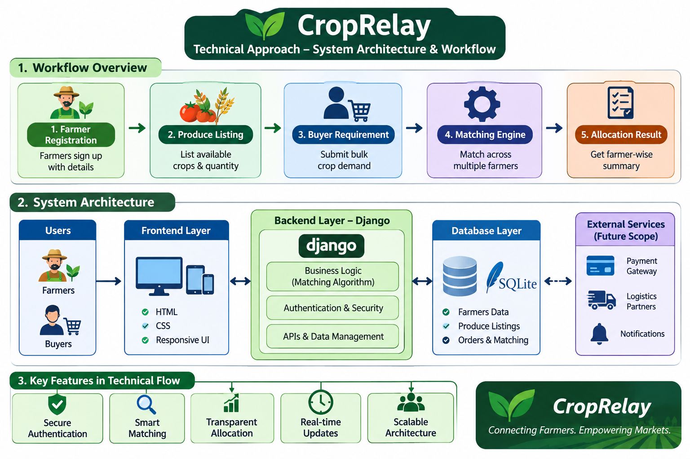

# Smart India Hackathon Workshop
# Date: 25/11/2026
## Reference Number: 26018145
## Name: Sujan S

## Problem Title
SIH 26033: Multiple intermediaries reduce farmers earnings and increase consumer prices.

## Problem Creater's Organization
Ministry of Consumer Affairs, Food & Public Distribution

## Theme
Agriculture, FoodTech & Rural Development

## Problem Description
Expected Solution: Create a digital marketplace that:

• Connects farmers/FPOs directly with consumers and bulk buyers.
• Provides logistics support.
• Uses AI for demand forecasting and route optimization.

Benefits:

• Better prices for farmers.
• Lower prices for consumers.
• Reduced supply chain inefficiencies.

## Proposed Solution
CropRelay is a demand-driven agricultural produce aggregation and matching platform that connects small-scale farmers directly with bulk buyers.

The platform allows buyers to submit bulk crop requirements, while individual farmers list their available produce, quantities, and prices. CropRelay intelligently matches a single buyer's requirement with produce from multiple farmers, allowing small farmers to collectively fulfil larger orders.

**How it addresses the problem:**

    1.Reduces dependence on multiple intermediaries.

    2.Helps farmers access larger market opportunities.

    3.Gives buyers a consolidated source for agricultural produce.

Provides transparent farmer-wise quantity and price allocation.

**Innovation and Uniqueness:**
Unlike conventional agricultural marketplaces that primarily connect individual sellers and buyers, CropRelay focuses on multi-farmer order aggregation. A single bulk order can be fulfilled through multiple small farmer listings, with price-based allocation and a transparent matching summary.

## Technical Approach
**Technologies Used:**

Programming Language: Python

Backend Framework: Django

Frontend: HTML, CSS

Database: SQLite

Development Environment: Visual Studio Code

### System Workflow Diagram

**Implementation Methodology:**

1.Farmer Registration – Farmers register with their basic details and location.

2.Produce Listing – Farmers add crop names, available quantities, harvest dates, and prices.

3.Buyer Requirement – Buyers submit crop requirements, target prices, quantities, and delivery locations.

4.Produce Matching – The system filters available listings based on crop type and target price.

5.Quantity Allocation – The system combines produce from multiple farmers, prioritising lower-priced eligible listings.

6.Matching Summary – The platform displays farmer-wise allocations, matched quantity, remaining quantity, total cost, and average price.

'''mermaid
flowchart TD
    A([Start]) --> B[Farmer Registration]
    B --> C[Farmer Adds Produce]
    C --> D[(SQLite Database)]
    E[Buyer Submits Order] --> F[Receive Crop, Quantity and Target Price]
    F --> G[Retrieve Available Produce]
    D --> G
    G --> H{Crop Matches and Price Within Target?}
    H -->|Yes| I[Sort Eligible Listings by Price]
    H -->|No| J[No Matching Produce]
    I --> K[Allocate Quantity Across Farmers]
    K --> L{Required Quantity Fulfilled?}
    L -->|Yes| M[Fully Matched]
    L -->|No, Some Produce Found| N[Partially Matched]
    L -->|No Produce Found| J
    M --> O[Calculate Total and Average Cost]
    N --> O
    O --> P[Display Farmer-wise Matching Summary]
    J --> P
    P --> Q([End])
    '''
    

## Feasibility and Viability
**Feasibility:**

CropRelay is technically feasible using widely available open-source technologies such as Python, Django, and SQLite. Its lightweight architecture allows the prototype to run on standard computers without expensive hardware or paid services.

**Potential Challenges and Risks:**

- Inaccurate information about available produce.

- Differences in crop quality and grading.

- Transportation coordination between multiple farmers.

- Changes in market prices and produce availability.

- Building trust between farmers and buyers.

**Strategies to Overcome Challenges:**

- Introduce produce verification and quality grading.

- Implement stock reservation to avoid duplicate allocations.

- Enable transparent farmer-wise pricing and quantity records.

- Integrate logistics coordination for aggregated orders.

- Provide order status updates and transaction records.

## Impact and Benefits
**Economic Impact:**

- Better market access for small-scale farmers.

- Potential reduction in intermediary-related costs.

- Opportunities to fulfil larger bulk orders collectively.

- More transparent price and quantity allocation.

**Social Impact:**

- Encourages collaboration among small farmers.

- Strengthens connections between farming communities and buyers.

- Supports fairer participation in agricultural markets.

**Environmental Impact:**

- Creates opportunities for coordinated transportation.

- Potentially reduces inefficient trips through consolidated deliveries.

- Helps improve planning around available agricultural produce.

**Target Audience:**

- Small and marginal farmers.

- Farmer Producer Organisations (FPOs).

- Wholesalers and retailers.

- Bulk agricultural buyers.

- Institutional buyers.

## Research and References
1.Ministry of Agriculture and Farmers Welfare, Government of India

2.e-NAM – National Agriculture Market

3.Digital India

4.Food and Agriculture Organization of the United Nations

These resources provide background on agricultural marketing, digital agricultural platforms, farmer market access, and supply-chain development.
